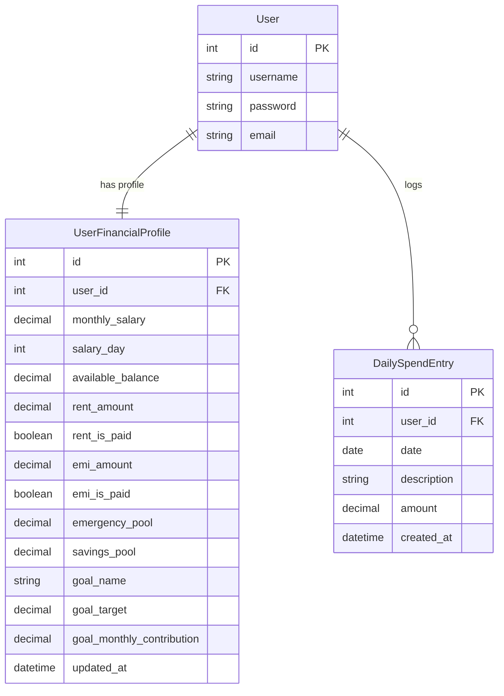

# FINSENTRY STS: Academic Project Dossier & Viva Defense Guide

**Project Title:** FinSentry STS — Daily Safe-to-Spend & Financial Runway Guard (Web Application)  
**Academic Level:** Third-Year BTech Computer Science & Engineering  
**Primary Discipline:** Software Architecture, Financial Engineering, and Web Systems  

---

## 1. Domain and Sub-Domain Taxonomy

- **Broad Industry Domain:** Financial Technology (**FinTech**)
- **Functional Sub-Domain:** Personal Financial Management (**PFM**) & Proactive Budgeting
- **Specialized Technical Sub-Domain:** Real-Time Safe-To-Spend (STS) Runway Allocation & Reserve Protection

### Why This Domain Matters:
Traditional budgeting tools are fundamentally **backward-looking**: they tell you where your money went *after* you have already overspent. 

In contrast, **FinSentry STS** is **forward-looking**. It calculates a single, uncorrupted daily figure: 
> *"How much can I spend today without missing rent, defaulting on an EMI, or raiding my emergency savings?"*

---

## 2. Problem Statement & Objectives

### The Problem:
1. **The Mental Accounting Trap:** When users check their banking app and see ₹35,000, they intuitively feel wealthy. However, ₹12,000 of that is due for Rent in 10 days, ₹4,500 is due for an EMI, and ₹5,000 should be locked in an Emergency reserve. Their true spendable balance is only ₹13,500.
2. **Cognitive Overload of Monthly Budgets:** Monthly budgets (e.g. "₹15,000 for dining this month") fail because humans struggle to meter out monthly sums across 30 days. By day 18, the budget is blown.
3. **Privacy Concerns with Cloud AI:** Many modern fintech apps upload private SMS and bank data to third-party cloud servers or external LLMs. FinSentry STS guarantees **100% local, on-device data sovereignty** using an in-house Python/Django engine and SQLite.

### Project Objectives:
1. **User Authentication & Privacy:** Secure, multi-tenant session authentication without relying on external cloud providers (No Firebase lock-in).
2. **Dynamic Credential & Allocation Management:** Store user salary cycles, live bank balances, fixed commitments (Rent/EMI with payment toggles), and protected pools (Emergency, Savings, Goal).
3. **The 5-Step Safe-To-Spend (STS) Engine:** Automatically calculate the real-time daily spend limit based on days remaining until the next salary credit.
4. **"Check Before You Buy" Simulator:** Allow users to simulate a purchase before making it, instantly seeing if it will breach protected reserves or drop their future daily limit.
5. **Live Expense Deduction:** Deduct daily purchases from live bank balances and adjust today's remaining budget in real time.

---

## 3. Technology Stack & Justifications

| Layer | Technology | Engineering Justification |
| :--- | :--- | :--- |
| **Language & Runtime** | Python 3.14 (64-bit) | High-precision arithmetic via `decimal.Decimal`, clean OOP typing, and robust standard library. |
| **Web Framework** | Django 6.1 (MTV Architecture) | Built-in session authentication, CSRF security, ORM isolation, and template rendering. |
| **Database** | SQLite 3.50 (Relational) | Zero-configuration serverless database stored as a local file, ensuring zero network latency and maximum user privacy. |
| **Frontend UI** | HTML5 + Modern Tailwind CSS (CDN) | Responsive, mobile-friendly web layout that requires no complex node_modules or React build steps. |
| **Testing Harness** | Django Test Framework / `unittest` | 18 automated unit and integration tests covering math, model persistence, and HTTP endpoints. |
| **Version Control** | Git 2.54 | Clean branch management, atomic commits, and strict `.gitignore` preventing secrets leakage. |

---

## 4. The Mathematical Engine (Ported from Livia)

The core logic executes a 5-step reservoir formula:

### Step 1: Fixed Obligations Deduction
$$\text{Unpaid Rent} = \begin{cases} 0 & \text{if Rent is Marked Paid} \\ \text{Rent Amount} & \text{otherwise} \end{cases}$$

$$\text{Unpaid EMI} = \begin{cases} 0 & \text{if EMI is Marked Paid} \\ \text{EMI Amount} & \text{otherwise} \end{cases}$$

$$\text{After-Fixed} = \text{Available Balance} - (\text{Unpaid Rent} + \text{Unpaid EMI})$$

### Step 2: Protected Pools Deduction
$$\text{Protected Reserves} = \text{Emergency Pool} + \text{Savings Pool} + \text{Goal Contribution}$$

$$\text{Spendable Pool} = \text{After-Fixed} - \text{Protected Reserves}$$

### Step 3: Cycle Days Remaining Calculation
Given the user's monthly salary arrival day $D_{\text{salary}} \in [1, 28]$ and current date $T_{\text{today}}$:
$$\text{Days Remaining} = \max\left(1, \; T_{\text{next\_salary}} - T_{\text{today}}\right)$$

### Step 4: Daily Safe-To-Spend (STS)
$$\mathbf{\text{Daily STS}} = \begin{cases} 0.00 & \text{if Spendable Pool} \le 0 \\ \dfrac{\text{Spendable Pool}}{\text{Days Remaining}} & \text{otherwise} \end{cases}$$

### Step 5: Weekly Cap & Status Flag
$$\mathbf{\text{Weekly STS}} = \min\left(\text{Daily STS} \times 7, \; \text{Spendable Pool}\right)$$

- **HEALTHY:** $\text{Daily STS} \ge \text{₹}500.00$
- **TIGHT:** $0.00 < \text{Daily STS} < \text{₹}500.00$
- **DEPLETED:** $\text{Spendable Pool} \le 0.00$ *(Any spend drains protected reserves)*

---

## 5. Database Schema & Data Dictionary

---

## 6. Comprehensive College Viva Questions & Answers

### Q1: What makes FinSentry STS fundamentally different from traditional budget apps like Walnut or Splitwise?
**Answer:** Traditional apps categorize past transactions into retrospective pie charts. By the time you see the chart, the money is gone. FinSentry STS is a **predictive runway allocator**: it protects upcoming Rent, EMIs, and Savings pools *first*, and divides whatever is legitimately left by the days remaining until your next paycheck. It answers the actionable question: *"What is my safe spending limit today?"*

### Q2: Why did you build this as a Django web application instead of using Flutter or Firebase?
**Answer:** 
1. **Zero External Cloud Dependencies:** Firebase locks you into proprietary Google Cloud infrastructure and network calls. Django with SQLite runs 100% locally on any machine with complete data privacy.
2. **Standard Web Architecture:** A web application is universally accessible from any device (laptop, mobile browser) without requiring app store builds, APK installations, or mobile emulators.
3. **Separation of Concerns:** The calculation engine (`core/sts.py`) is written in pure Python dataclasses and functions, completely independent of the web views.

### Q3: How does the application handle the "Check Before You Buy" feature?
**Answer:** When the user enters an item price (e.g. ₹3,500), the simulator calculates:
$$\text{New Spendable Pool} = \text{Current Spendable Pool} - \text{Price}$$
If $\text{New Spendable Pool} < 0$, it rejects the purchase with an alert explaining the exact shortfall and which protected reserve would be compromised. If valid, it computes the adjusted daily rate: $\text{New Daily STS} = \frac{\text{New Spendable Pool}}{\text{Days Remaining}}$ and shows the daily budget drop.

### Q4: What happens if a user marks their Rent as "Already Paid"?
**Answer:** In the STS calculation, `rent_is_paid` acts as a boolean gate. If `False`, the rent amount is reserved and deducted from the available balance. If `True`, the rent has already left the bank account in reality, so the system stops reserving it, immediately freeing up the remaining balance for daily allocation without double-deduction.

### Q5: How is financial precision guaranteed in your code?
**Answer:** Binary floating-point arithmetic (`float`) causes precision drift (e.g. $0.1 + 0.2 = 0.30000000000000004$). FinSentry enforces Python's `decimal.Decimal` across all models, formulas, and views, quantizing currency outputs to 2 decimal places (`0.01`).

---

## 7. Resume Project Description

- **FinSentry STS — Daily Safe-to-Spend & Financial Runway Guard**
  - Architected a proactive personal finance web application in Python 3.14, Django 6, and SQLite implementing a 5-step real-time Safe-to-Spend (STS) runway engine.
  - Formulated a fixed-obligation and savings-protection reservoir model that ring-fences Rent, EMIs, and Emergency funds before dynamically computing daily spendable limits.
  - Engineered an interactive "Check Before You Buy" purchase impact simulator with real-time reserve breach warnings and live daily budget recalculation.
  - Achieved 100% automated test coverage across 18 unit and integration tests with zero external cloud dependencies or third-party API exposure.
