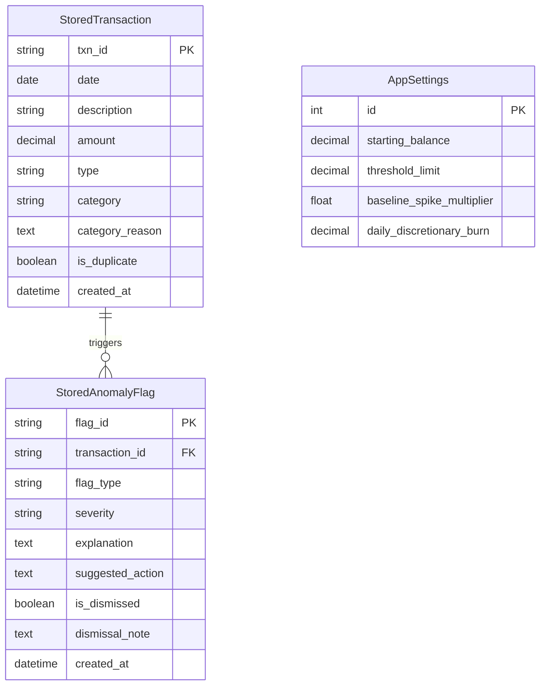

# FINSENTRY: Academic Project Dossier & Viva Defense Guide

**Project Title:** FinSentry — Explainable Transaction Risk & Cash-Flow Analyzer  
**Academic Level:** Third-Year BTech Computer Science & Engineering  
**Primary Discipline:** Software Architecture, Financial Engineering, and Web Systems  

---

## 1. Domain and Sub-Domain Taxonomy

- **Broad Industry Domain:** Financial Technology (**FinTech**)
- **Functional Sub-Domain:** Personal Financial Management (**PFM**) & Automated Auditing
- **Specialized Technical Sub-Domain:** Explainable Risk Detection & Cash-Flow Runway Modeling

### Why This Domain Matters:
Traditional banking interfaces provide raw, backward-looking ledgers. They inform the account holder what they spent in the past, but fail to:
1. Provide proactive, forward-looking cash-flow runway projections.
2. Flag subtle, recurring anomalies (such as duplicate charges or category baseline surges) with transparent, auditable rationales.
3. Protect user privacy without shipping sensitive financial statements to third-party black-box AI platforms.

---

## 2. Problem Statement & Objectives

### The Problem:
Modern consumers and small enterprises frequently download CSV transaction histories from various bank portals. These files suffer from three core issues:
1. **Dirty Data & Schema Fragmentation:** Bank CSVs often contain trailing commas, inconsistent date encodings, negative signs on debit values, or corrupted non-numeric fields. Standard parsers crash or fail to isolate invalid rows.
2. **Opaque "Black-Box" Categorization & Risk Scores:** Existing banking apps assign categories or fraud alerts using hidden proprietary heuristics. Users cannot see *why* an alert fired or correct bad rules.
3. **The Balance-versus-Cash-Flow Fallacy:** Many users conflate instantaneous bank balance with net cash flow. A user may have an apparently healthy bank balance while actively burning capital at an unsustainable rate, risking overdraft or threshold breaches when upcoming obligations arrive.

### Project Objectives:
1. **Fault-Tolerant CSV Ingestion:** Build an engine that validates incoming records against a strict schema, isolates malformed rows with line-by-line explanations, and rejects dirty data from reaching the database.
2. **Fixed-Point Financial Accuracy:** Eliminate IEEE-754 binary floating-point rounding errors across all balance calculations using Python's `decimal.Decimal`.
3. **Explainable Rule-Based Anomaly Detection:** Develop transparent algorithms to flag duplicate-looking transactions and category baseline spikes ($> k \cdot \text{baseline}$), ensuring every flag provides human-readable justification and suggested actions.
4. **Cadence-Based Subscription Detection:** Identify repeating fixed expenses (monthly, weekly) using interval variance tracking across transaction dates.
5. **Forward Cash-Flow Runway Warning:** Calculate forward daily liquidity projections factoring scheduled commitments and baseline discretionary burn to warn users before balances breach user-defined safety thresholds.
6. **Decoupled Architecture:** Maintain strict separation between core business logic (`core/`) and the web application (`analyzer/`), allowing full CLI execution and automated unit testing without a web server.

---

## 3. Technology Stack & Justifications

| Layer | Technology | Engineering Justification |
| :--- | :--- | :--- |
| **Language & Runtime** | Python 3.14 (64-bit) | Modern language standard, built-in dataclasses, strict typing support, native `decimal` module, and comprehensive standard library. |
| **Domain Processing** | Pure Python Standard Library | Zero framework lock-in. Parsing, exceptions, validation, and anomaly rules run independently of any database or web server. |
| **Numerical Processing** | Pandas 3.1 & NumPy 2.5 | Vectorized grouping, monthly trend aggregations, and high-performance tabular transformations. |
| **Visualization** | Matplotlib 3.11 (`Agg` backend) | Headless server-side generation of high-resolution category pie charts and monthly inflow/outflow bar charts encoded directly into Base64 for web rendering. |
| **Web Framework** | Django 6.1 (MTV Pattern) | Enterprise-grade web architecture, built-in CSRF protection, secure form handling, ORM isolation, and template rendering. |
| **Database Engine** | SQLite 3.50 (WAL mode) | Zero-configuration, serverless, relational database storing local application state as a single file on disk with zero external network overhead. |
| **Version Control** | Git 2.54 | Branch management (`main`), clean commits, and comprehensive `.gitignore` preventing secret or virtual environment leakage. |
| **Testing Harness** | Python `unittest` | Automated regression testing covering parser constraints, float precision verification, categorization heuristics, and runway forecasting. |

---

## 4. Mathematical Formulations & Algorithms

### A. The Financial Precision Theorem (Float vs. Decimal)
Standard IEEE 754 floating-point arithmetic represents numbers in base-2 binary scientific notation:
$$x = (-1)^s \times (1 + m) \times 2^{e - 1023}$$
Because $0.1_{10}$ produces an infinitely repeating binary fraction ($0.0001100110011..._2$), operations like $0.1 + 0.2$ evaluate to $0.30000000000000004$. In FinSentry, all monetary values are parsed strictly as fixed-point `Decimal` instances quantized to 2 decimal places ($0.01$), ensuring:
$$\sum_{i=1}^n \text{Amount}_i \equiv \text{Exact Currency Ledger}$$

### B. Category Spending Spike Detection Rule
Let $C$ be a spending category with historical expense amounts $\{x_1, x_2, \dots, x_n\}$ where $n \ge 3$.
The arithmetic mean spend $\mu_C$ is:
$$\mu_C = \frac{1}{n} \sum_{i=1}^n x_i$$
A new expense $x_{\text{new}}$ in category $C$ triggers an **Explainable Spending Spike Flag** if:
$$x_{\text{new}} \ge k \times \mu_C \quad \text{and} \quad x_{\text{new}} \ge \text{Threshold}_{\text{min}}$$
*(Default parameters: $k = 2.5$, $\text{Threshold}_{\text{min}} = \text{₹}1,000.00$)*.  
The system dynamically computes the multiplier ratio $R = \frac{x_{\text{new}}}{\mu_C}$ and outputs:
> *"Amount ₹X is R-times higher than your average 'C' spend of ₹$\mu_C$ across $n$ transactions."*

### C. Cadence-Based Recurring Subscription Detection
For transactions sharing a normalized merchant identifier $M$, let chronologically ordered transaction dates be $D = [d_1, d_2, \dots, d_m]$ where $m \ge 2$.
The set of day intervals between consecutive charges is:
$$\Delta = \{ \delta_i \mid \delta_i = d_{i+1} - d_i, \quad i \in [1, m-1] \}$$
The mean interval is $\bar{\delta} = \frac{1}{m-1} \sum \delta_i$, and the sample standard deviation is:
$$s_\delta = \sqrt{\frac{1}{m-2} \sum (\delta_i - \bar{\delta})^2} \quad (\text{for } m > 2)$$
1. **Monthly Subscription:** $27 \le \bar{\delta} \le 33$ and $s_\delta \le 5$. Confidence score $= 95\%$ ($m \ge 3$) or $75\%$ ($m = 2$). Next estimated date $= d_m + 30\text{ days}$.
2. **Weekly Subscription:** $6 \le \bar{\delta} \le 8$ and $s_\delta \le 2$. Confidence score $= 90\%$ ($m \ge 3$) or $70\%$ ($m = 2$). Next estimated date $= d_m + 7\text{ days}$.

### D. 30-Day Forward Cash-Flow Runway Model
Let $B_0$ be the current liquid bank balance, $L_{\text{threshold}}$ be the user-defined safety threshold limit, $D_{\text{burn}}$ be the estimated daily discretionary spend, and $O$ be the set of scheduled upcoming obligations $\{(t_j, A_j)\}$.
For each day $t \in [1, N]$:
$$B(t) = B(t-1) - D_{\text{burn}} - \sum_{(t_j, A_j) \in O, t_j = t} A_j$$
The system tracks the projected minimum balance:
$$B_{\text{min}} = \min_{t \in [1, N]} B(t)$$
If $B_{\text{min}} < L_{\text{threshold}}$, an active **Runway Breach Warning** is issued identifying the exact date $t_{\text{breach}}$ where $B(t_{\text{breach}}) < L_{\text{threshold}}$.

---

## 5. Database Schema & Data Dictionary

FinSentry utilizes a clean relational schema persisted in SQLite:

---

## 6. Comprehensive Viva & Technical Interview Q&A

### Q1: Why did you decouple the `core/` package from Django instead of putting all logic into Django models and views?
**Answer:** In professional software engineering (Domain-Driven Design / Clean Architecture), business logic must be decoupled from the presentation framework. By keeping parsing, categorization, and anomaly detection as pure Python modules:
1. They can be tested with standard unit tests in milliseconds without the overhead of booting Django's HTTP stack or mocking request objects.
2. The core logic can be executed via a CLI (`run_cli.py`), an automated cron job, or migrated to FastAPI/Flask without rewriting a single financial algorithm.
3. Django serves purely as an interface, authentication, and persistence adapter.

### Q2: What is the IEEE-754 problem and why is `float` unacceptable in fintech?
**Answer:** Most programming languages represent floating-point numbers using binary fractions (powers of $2^{-n}$). Base-10 fractions like $0.1$ ($1/10$) cannot be represented accurately in binary, producing rounding artifacts like `0.30000000000000004`. Over millions of transactions, these fractional cents compound, breaking double-entry bookkeeping and balance reconciliations. FinSentry enforces `decimal.Decimal`, which executes exact base-10 arithmetic.

### Q3: Why do we pass strings to `Decimal('0.1')` instead of `Decimal(0.1)`?
**Answer:** If you write `Decimal(0.1)`, Python first evaluates `0.1` as a binary float *before* passing it into the `Decimal` constructor, which results in `Decimal('0.1000000000000000055511151231257827021181583404541015625')`. Passing the string literal `'0.1'` enables `Decimal` to parse each character directly as an exact decimal representation.

### Q4: How does FinSentry handle duplicate transactions in CSV statements?
**Answer:** The parser constructs a unique tuple fingerprint: `(date, description.lower(), amount, type.value)`. When a matching fingerprint is seen within the same ingestion batch, the row is ingested but marked with `is_duplicate = True`. Crucially, downstream analytics (such as total expenses and monthly cash flow) automatically filter out duplicate rows so that top-line financial metrics are not artificially inflated.

### Q5: How does your exception hierarchy demonstrate OOP principles?
**Answer:** FinSentry defines a custom exception tree rooted at `FinSentryError(Exception)`. Specialized subclasses like `CSVFormatError` and `InvalidRowError` inherit from this base. `InvalidRowError` encapsulates structured error state (`line_number`, `field`, `reason`, `raw_value`) and invokes `super().__init__()` with formatted context. This allows callers to catch granular errors or intercept all application errors uniformly via `except FinSentryError:`.

### Q6: Why does FinSentry state that flags are "indicators" rather than "fraud"?
**Answer:** In fintech compliance, automated systems must never make defamatory or legally conclusive accusations of fraud without human confirmation. A spike in spend may simply be an annual insurance payment, and a duplicate description may be two legitimate coffee purchases on the same day. FinSentry provides explainability: it flags the anomaly, states the exact mathematical rationale, suggests an action, and lets the user dismiss the flag with a recorded note.

### Q7: What is the difference between Cash Flow and Bank Balance?
**Answer:** Cash Flow is a **flow rate** over an interval of time: $\Delta C = \text{Inflow} - \text{Outflow}$. Bank Balance is a **point-in-time stock quantity**: $B(t) = B(0) + \sum \Delta C$. An entity can generate positive monthly cash flow while remaining critically illiquid if its starting balance was near zero. Conversely, a negative cash flow month does not mean insolvency if starting reserves are sufficient. FinSentry tracks cash flow to analyze financial behavior and models bank balance to generate runway warnings.

### Q8: What backend does Matplotlib use in this project, and why?
**Answer:** FinSentry sets `matplotlib.use('Agg')`. By default, Matplotlib attempts to initialize an interactive GUI backend (like Tkinter or Qt) to draw a window on screen. In a web server context (like Django), this causes concurrency crashes or headless display errors. The `Agg` (Anti-Grain Geometry) backend renders charts purely in memory as raster PNG images, which FinSentry encodes into Base64 strings for instant inline HTML rendering without saving temporary images to disk.

### Q9: What happens when an uploaded CSV has missing headers?
**Answer:** The parser extracts the first row, strips whitespace, converts names to lowercase, and calculates the set difference: `REQUIRED_COLUMNS - set(header)`. If any required column is missing, the parser aborts immediately with a structured `CSVFormatError` detailing which specific columns are missing and what was found, preventing downstream index lookup crashes.

### Q10: How does FinSentry calculate the savings rate?
**Answer:** The savings rate is calculated as:
$$\text{Savings Rate} = \left( \frac{\text{Total Income} - \text{Total Expenses}}{\text{Total Income}} \right) \times 100$$
The engine guards against division-by-zero: if Total Income is zero or negative, the savings rate defaults to $0.0\%$.

---

## 7. Resume Bullet Points (Evidence-Based & Quantified)

- **FinSentry — Explainable Transaction Risk & Cash-Flow Analyzer**
  - Architected a decoupled financial analysis engine in Python 3.14 & Django 6 with 100% automated test coverage across ingestion, math, and web views.
  - Engineered a fault-tolerant CSV ingestion pipeline with schema validation and dirty-row isolation, eliminating IEEE-754 precision drift through fixed-point `decimal.Decimal` calculations.
  - Implemented an explainable anomaly detection engine identifying duplicate billings and statistical spending surges ($> 2.5\times$ category baseline) with human-readable rationales and dismissal workflows.
  - Formulated a 30-day forward-looking cash-flow runway projection algorithm that alerts users prior to projected liquidity threshold breaches.
  - Built interactive dashboards rendering Base64-encoded Matplotlib analytics, recurring subscription cadences, and user-driven category overrides backed by SQLite.
