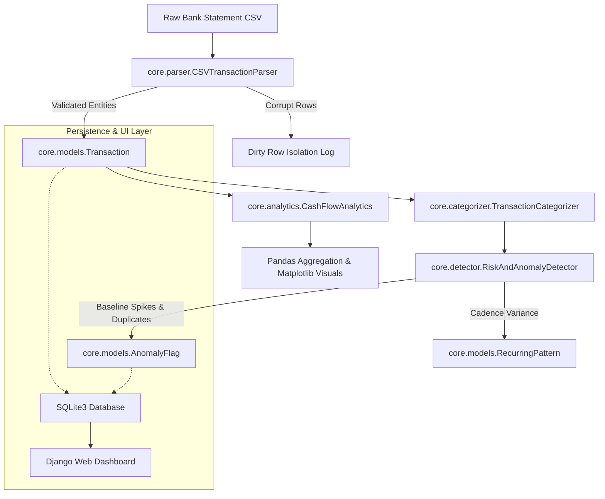

# FinSentry — Explainable Transaction Risk & Cash-Flow Analyzer


FinSentry is a secure, explainable personal finance risk engine and cash-flow analyzer built to provide transparent, rule-based auditing of transaction histories without sending private financial data to external cloud services or black-box AI APIs.

---

## 🌟 Key Highlights & Engineering Features

- **Strict Schema Validation & Dirty Row Isolation**: Ingests raw CSV statements, validates types, dates, and amounts using fixed-point `Decimal` arithmetic, and isolates corrupt rows without crashing.
- **Explainable Categorization Engine**: Classifies income and expenditure using transparent keyword/regex heuristics and records human-readable reasoning (`category_reason`) for every assignment.
- **Explainable Anomaly Flags**: Detects duplicate charges, unusual frequency velocity, and statistical baseline spending spikes ($> k \cdot \text{baseline}$). Every alert explains its trigger reason and suggested action.
- **Recurring Payment Detection**: Groups merchant histories and identifies regular weekly/monthly billing cycles with confidence scores.
- **Forward-Looking Cash-Flow Runway Warning**: Forecasts daily balances over 30-day windows to detect threshold breaches before scheduled obligations arrive.
- **Decoupled Architecture**: Pure Python domain engine (`core/`) is 100% decoupled from the presentation framework (`Django`). Fully verifiable via CLI or automated tests without booting a web server.

---

## 🏗️ System Architecture & Data Flow



---

## 📁 Repository Structure

```
finsentry/
├── core/                        # Pure Domain Logic (No Web Dependency)
│   ├── __init__.py
│   ├── exceptions.py            # Domain exception hierarchy (OOP)
│   ├── models.py                # Pure Python dataclasses
│   ├── parser.py                # CSV validator & dirty row isolator
│   ├── categorizer.py           # Rule-based explainable categorizer
│   ├── analytics.py             # Cash-flow calculations & Matplotlib charts
│   └── detector.py              # Anomaly detection & runway projection
│
├── analyzer/                    # Django Application Layer
│   ├── migrations/              # SQLite database schema migrations
│   ├── models.py                # StoredTransaction, StoredAnomalyFlag, AppSettings
│   ├── views.py                 # Dashboard, upload, ledger, review controllers
│   ├── urls.py                  # Route bindings
│   └── tests.py                 # Django integration tests
│
├── config/                      # Django Project Configuration
│   ├── settings.py
│   └── urls.py
│
├── data/
│   └── sample_transactions.csv  # Synthetic test data with intentional edge cases
│
├── templates/                   # Clean Tailwind CSS Web UI
│   ├── base.html
│   ├── dashboard.html
│   ├── upload.html
│   ├── transactions.html
│   ├── anomalies.html
│   └── settings.html
│
├── tests/                       # Unit Test Suite
│   ├── __init__.py
│   └── test_core.py
│
├── manage.py                    # Django management script
├── run_cli.py                   # Pure terminal / CLI runner
├── seed_sample_data.py          # Quick database population script
├── requirements.txt             # Pinned production dependencies
└── PROJECT_DOSSIER.md           # College Viva, Theory & Interview Guide
```

---

## 🚀 Quickstart & Execution

### 1. Prerequisites
- Windows 11 / Linux / macOS
- Python 3.10+ (Tested on Python 3.14)
- Git

### 2. Environment Setup
```powershell
# Clone or navigate to the repository
cd finsentry

# Activate your existing virtual environment
.\.venv\Scripts\Activate.ps1

# Install dependencies (if setting up fresh)
pip install -r requirements.txt
```

### 3. Run Standalone CLI (Terminal Mode)
```powershell
python run_cli.py
```

### 4. Run Automated Test Suite
```powershell
python manage.py test
```
*Executes all 14 unit and integration test assertions across parsing, math, anomalies, and views.*

### 5. Launch the Web Interface
```powershell
# Populate database with sample dataset
python seed_sample_data.py

# Launch development web server
python manage.py runserver
```
Open **[http://127.0.0.1:8000](http://127.0.0.1:8000)** in your browser.

---

## 🔒 Security & Privacy Model

1. **Zero External Cloud Egress**: FinSentry processes statements entirely inside your local execution boundary. No banking credentials or private records are ever uploaded to third-party APIs.
2. **Deterministic & Explainable**: No opaque black-box AI models that hallucinate risk scores. Every anomaly outputs its exact triggering condition.
3. **Defense Against Decimal Drift**: Rejects standard IEEE-754 binary floats in favor of Python's fixed-point `decimal.Decimal` to ensure exact balance reconciliation.

---

## 📜 Academic & Viva Specifications

For full college project specifications, domain theory, system architecture, database schema, and viva preparation questions, refer to [PROJECT_DOSSIER.md](PROJECT_DOSSIER.md).
