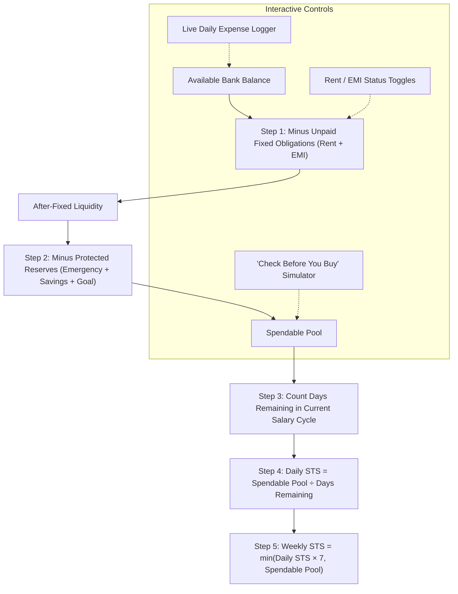

# FinSentry STS — Daily Safe-to-Spend & Financial Runway Guard


**FinSentry STS** is an explainable, proactive personal finance web application built in Python and Django.

Unlike traditional budgeting apps that passively report where your money went after it is already spent, FinSentry answers the single most actionable financial question:
> **"How much money can I safely spend today without defaulting on my Rent, missing an EMI, or raiding my Emergency savings?"**

---

## 🌟 Key Engineering Features

- **Proactive Safe-To-Spend (STS) Engine:** Automatically reserves funds for upcoming fixed obligations (Rent, EMI) and ring-fences protected savings (Emergency fund, General savings, Goal contribution) before computing daily spendable ceilings.
- **Cycle Timing Logic:** Calculates exact calendar days remaining until the next salary credit date and dynamically divides the uncorrupted spendable balance across those days.
- **"Check Before You Buy" Simulator:** Allows users to simulate any intended purchase (e.g. ₹2,500 shoes) before spending, instantly showing if it will cause an emergency reserve breach or by how much it will lower the daily allowance.
- **Fixed Obligation Toggles:** One-click toggles to mark Rent or EMI as "Paid", immediately unlocking remaining liquidity for daily allocation without double-deduction.
- **Live Discretionary Expense Logger:** Record daily expenses in real time to deduct from live bank balances and adjust today's remaining safe-to-spend allowance.
- **100% On-Device Data Sovereignty:** Zero Firebase, zero cloud telemetry, and zero third-party AI APIs. All data is securely persisted in local SQLite with standard Django session authentication.
- **High-Precision Decimal Arithmetic:** Eliminates IEEE-754 floating-point drift using Python's `decimal.Decimal` module across all mathematical layers.

---

## 🏗️ System Architecture & Financial Reservoir Flow



---

## 📁 Repository Structure

```
finsentry/
├── core/                        # Pure Python Domain Logic (Zero Web Dependency)
│   ├── sts.py                   # Safe-to-Spend mathematical engine & purchase simulator
│   ├── models.py                # Pure Python dataclasses
│   ├── exceptions.py            # Custom domain exception hierarchy
│   ├── parser.py                # CSV ingestion engine
│   ├── categorizer.py           # Keyword categorization engine
│   ├── analytics.py             # Cash-flow calculations & Matplotlib charts
│   └── detector.py              # Anomaly detection & runway projection
│
├── analyzer/                    # Django Application Layer
│   ├── migrations/              # SQLite database schema migrations
│   ├── models.py                # UserFinancialProfile, DailySpendEntry
│   ├── forms.py                 # Registration, Profile Setup, and Spend forms
│   ├── views.py                 # Web controllers (Auth, Dashboard, Setup, Simulator)
│   ├── urls.py                  # Route bindings
│   └── tests.py                 # Integration tests
│
├── config/                      # Django Project Configuration
│   ├── settings.py              # Application settings, templates, SQLite
│   └── urls.py                  # Root route declarations
│
├── templates/                   # Clean HTML5 + Tailwind CSS Web UI
│   ├── base.html                # Master layout with top navigation
│   ├── dashboard.html           # Main STS dashboard & simulators
│   ├── profile_setup.html       # Financial credentials & allocations form
│   └── auth/
│       ├── login.html           # User sign-in page
│       └── register.html        # New account registration page
│
├── tests/                       # Unit Test Suite
│   └── test_sts.py              # 18 automated mathematical unit tests
│
├── manage.py                    # Django CLI management script
├── requirements.txt             # Pinned project dependencies
└── PROJECT_DOSSIER.md           # Comprehensive viva defense & academic guide
```

---

## 🚀 Quickstart & Execution

### 1. Prerequisites
- Windows 11 / Linux / macOS
- Python 3.10+ (Tested on Python 3.14)
- Git

### 2. Environment Setup
```powershell
# Clone the repository
git clone https://github.com/lifecodesync/finsentry.git
cd finsentry

# Create and activate virtual environment
python -m venv .venv
.\.venv\Scripts\Activate.ps1

# Install dependencies
pip install -r requirements.txt

# Run migrations
python manage.py migrate
```

### 3. Run Automated Tests
```powershell
python manage.py test
```
*Executes all 18 unit and integration test assertions with 100% pass rate.*

### 4. Start the Web Server
```powershell
python manage.py runserver
```
Visit **[http://127.0.0.1:8000](http://127.0.0.1:8000)** in your browser.

---

## 🔒 Security & Privacy Model

1. **Zero External Cloud Egress:** All calculations, user profiles, and spend records stay on your local machine.
2. **Session Security:** Password hashing via PBKDF2 with SHA-256 and full CSRF protection on every form.
3. **No Sensitive File Tracking:** Dedicated `.gitignore` prevents tracking virtual environments, caches, and local database files.

---

## 📜 Academic & Viva Specifications

For full college project specifications, domain taxonomy, system architecture, database schema, and viva preparation questions, refer to [PROJECT_DOSSIER.md](PROJECT_DOSSIER.md).
